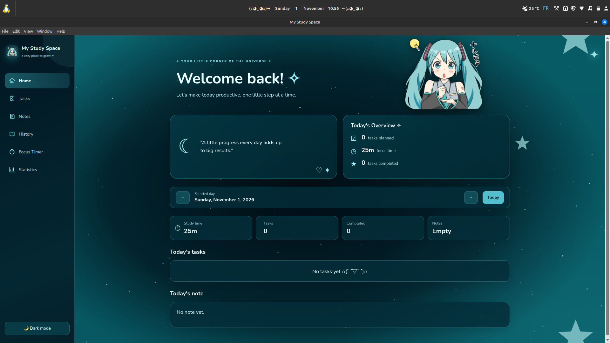
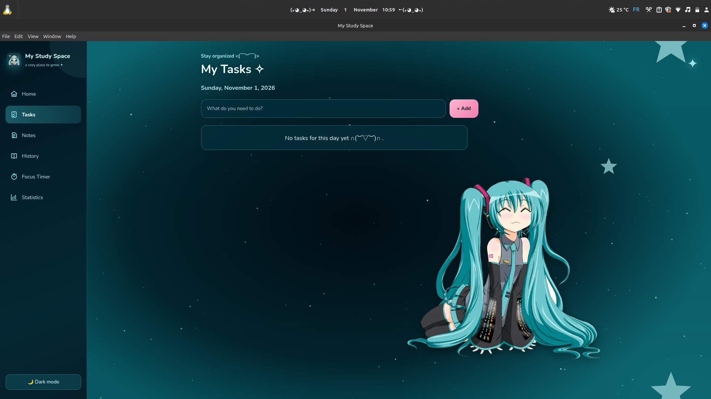
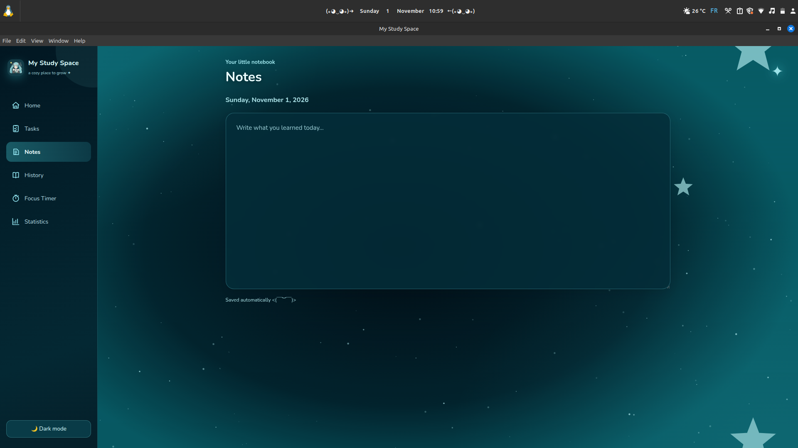
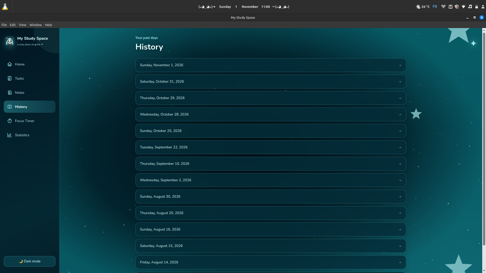
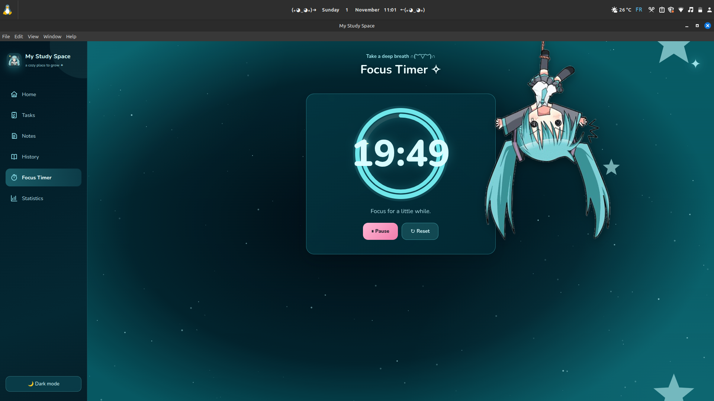
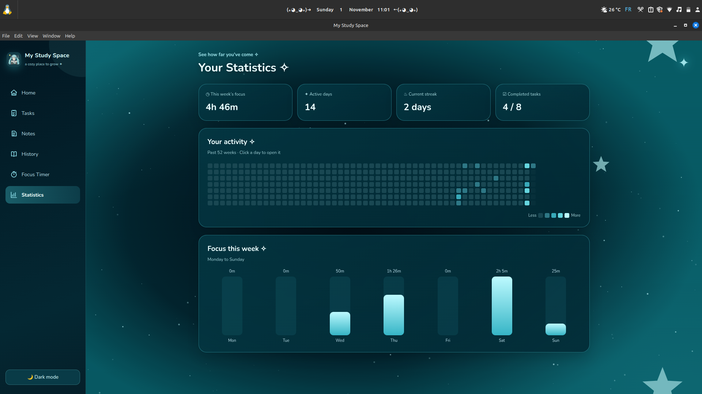

# 39space

A cozy, Miku-inspired desktop app for organizing daily tasks, taking notes, tracking study time, and visualizing study progress.
Built with Electron, JavaScript, and SQLite, 39space helps you stay productive in your own little study corner. (づ｡◕‿‿◕｡)づ
   

## Features

- **Home** — Get a quick overview of your selected day, including:

* Total study time for the day

* Number of tasks

* Completed tasks

* Daily note preview

* Navigation between different dates

  

- **Tasks** — Organize your tasks for each day.

* Add new tasks

* Mark tasks as completed

* Delete tasks

* View tasks for different dates

* Automatically update task statistics

  

- **Notes** — Keep a little record of what you learned each day.

* Write notes for any selected date

* Automatic saving while typing

* Edit or clear existing notes

* Store notes locally using SQLite

  

- **History** — Browse your previous study days.

* View dates with recorded activity

* Click a date to revisit its tasks, notes, and study time

* Automatically exclude empty days

A day appears in History only if it contains at least one task, a nonempty note, or recorded study time.
  

- **Focus Timer** — Stay focused using a simple Pomodoro-style timer.

* 25-minute focus sessions

* Start, pause, and reset the timer

* Automatically save accumulated focus time

* Track study time for each day


  

  - **Statistics** —

Visualize your study habits and track your progress over time.

* GitHub-style contribution calendar — displays daily study activity using colored squares

* Weekly focus time — shows the total time studied during the current week (Monday–Sunday)

* Weekly study graph — compares study time across the last seven days

* Study streaks — tracks consecutive days with activity

* Active days — counts days containing study activity

* Completed tasks — displays your task completion progress

Click a day in the activity calendar to revisit its records.

All statistics are calculated using your locally stored data.


  

- Light/dark mode

- **Appearance**_

* Miku-inspired turquoise color palette

* Dark and light modes

* Starry background with decorative stars and sparkles

* Responsive desktop layout


## Tech stack

- [Electron](https://www.electronjs.org/) :  desktop application framework
- [better-sqlite3](https://github.com/WiseLibs/better-sqlite3) for local storage
- HTML5 — application structure
- CSS3 — styling and animations
- JavaScript — application logic

## Getting started

- **Prerequisites**

Make sure you have Node.js and npm installed.

- ** Installation**

Clone the repository:

```bash
git clone https://github.com/YOUR-USERNAME/39space.git
cd 39space
npm install
npm start
```

## Building an AppImage (Linux)

```bash
npm run dist
```

The AppImage will be generated in `dist/`.

## Data storage

All data (notes, tasks, study time) is stored locally in a SQLite database under your OS's user data folder


## License

MIT 
---
Made with  (≧◡≦) ♡